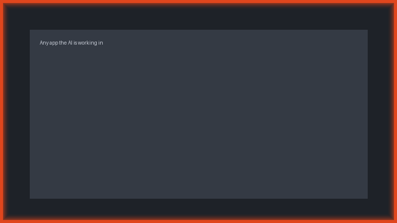
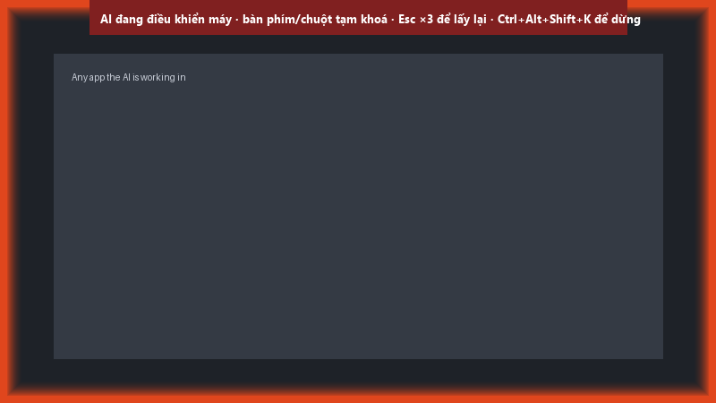

# turbo-desktop-mcp

An MCP server that lets an AI agent drive Windows desktop apps through UI Automation (UIA) with compact accessibility snapshots and delta diffs. It runs standalone on Windows 10/11 without needing the remote hub or phone app.

Tools: `windows_list`, `inspect_compact`, `act`, `batch_actions`, `launch_app`, `wait_for`, `window_control`, `screenshot`, `system_state`.

## Install

Requires Windows 10/11 and Python 3.12 or newer.

### Quick run with `uvx` or `pipx`

```powershell
uvx turbo-desktop-mcp
# or
pipx run turbo-desktop-mcp
```

### Install with `pip`

```powershell
pip install turbo-desktop-mcp
```

### From a local checkout

```powershell
cd desktop-mcp
python -m venv .venv
.venv\Scripts\python -m pip install -e .
```

### Claude Code

With `uvx`:

```powershell
claude mcp add turbo-desktop -e PYTHONUTF8=1 -- uvx turbo-desktop-mcp
```

From a local `.venv`:

```powershell
claude mcp add turbo-desktop -e PYTHONPATH=D:\path\to\desktop-mcp\src -e PYTHONUTF8=1 -- D:\path\to\desktop-mcp\.venv\Scripts\python.exe -m turbo_desktop
```

### Claude Desktop

Edit `%APPDATA%\Claude\claude_desktop_config.json`:

```json
{
  "mcpServers": {
    "turbo-desktop": {
      "command": "uvx",
      "args": ["turbo-desktop-mcp"],
      "env": {
        "PYTHONUTF8": "1",
        "TURBO_DESKTOP_LANG": "en"
      }
    }
  }
}
```

### Language (`TURBO_DESKTOP_LANG=en|vi`)

All user-facing overlay banners, takeover notices, approval prompts, and error messages default to English (`TURBO_DESKTOP_LANG=en`). Set `TURBO_DESKTOP_LANG=vi` in the server environment to switch user-facing banners and prompts to Vietnamese.

## How the AI uses it

1. `windows_list` lists top-level windows (`w1`, `w2`, ...). `launch_app` starts an app and returns its first compact snapshot.
2. `inspect_compact(window)` returns one line per control: `[w1:e12] <Button> "Save"`, with values (`= "text"`) and states (`[checked]`, `[disabled]`). Refs stay stable between calls. After the first call, `onlyChanged=true` returns only new (`*`), changed (`~`) and removed (`-`) elements.
3. `act(ref=..., action=...)`: `click`, `invoke`, `type` (append), `set_value` (replace), `select`, `toggle`, `expand`, `focus`, `read`, `scroll`, `press_keys`, `send_text` (real typing, checked by read-back). The server tries UIA patterns first (`via: "pattern"`). Real mouse and keyboard input (`via: "input"`) acts as a fallback and waits until you stop using the PC.
4. `batch_actions(steps, returnSnapshot)` runs several steps in one call and stops at the first error.
5. If a window has no accessible tree (custom-drawn apps, games), `inspect_compact` reports `treeEmpty: true` and returns lines found by Windows OCR, such as `[w1:o3] text "Save" @412,230`. Clicking an OCR ref uses real input.
6. **Prefer keyboard shortcuts (`Ctrl+S`, `Ctrl+O`) over UIA `Invoke` on WinForms menu items that open modal dialogs:** WinForms runs modal dialog loops (`SaveFileDialog`, `OpenFileDialog`) inside the synchronous UIA `Invoke` handler, which blocks subsequent UIA calls to that process until the dialog closes. Use `act(window=..., action="press_keys", keys="Ctrl+S")` whenever a shortcut exists.

The server wraps all screen text in `<<<SCREEN_CONTENT ...>>>` markers so the model treats screen text as untrusted data.

## Safety

Rules in `rules/default_rules.toml` allow, prompt for, or deny each action. When a rule requires approval (`level = "ask"`):

- With the phone app connected, the hub sends the approval request to the phone.
- Otherwise a local Windows dialog prompts Yes/No. If you do not answer within 2 minutes, the server denies the action.

Hardcoded safeguards (cannot be disabled in config): the server redacts password-field values and refuses to type into them, the `STOP` file (created by the emergency hotkey) blocks all actions, and an append-only, hash-chained audit log records each call (`tmp/state/audit.jsonl`, or `TURBO_DESKTOP_AUDIT`).

Other safeguards:

- Real input waits while you use the mouse or keyboard (up to 10 s for 5 s of idle, then fails with `owner is using the PC`). Afterward, it restores your previous foreground window and cursor position.
- Elevated windows appear with `elevated: true, actionable: false`. The server refuses actions on them because Windows UIPI blocks non-elevated input.
- `system_state` reports a UAC prompt or lock screen (`secureDesktopActive`), idle seconds, and battery status.

## Input lock (real input only)

When the AI sends real keyboard or mouse input (no UIA pattern available, OCR clicks, `press_keys`, `send_text`), `InputLock` pauses your physical keyboard and mouse for the duration of that action so physical movement does not disrupt the sequence. It uses low-level Win32 keyboard and mouse hooks (`WH_KEYBOARD_LL`, `WH_MOUSE_LL`) without needing administrator rights, passing through the server's own injected events. While the lock is held, a banner at the top of the screen displays `"AI is controlling the PC · keyboard/mouse paused · Esc ×3 to take over · Ctrl+Alt+Shift+K to stop"` (or Vietnamese when `TURBO_DESKTOP_LANG=vi`), and a green notice appears when control returns to you. UIA-pattern actions do not lock input.

Built-in release triggers (hardcoded):

- **Ctrl+Alt+Shift+K**: emergency STOP (creates the `STOP` file, releases the lock, and blocks subsequent actions).
- **Esc three times within 1.5 s**: owner takeover. The server releases the lock and returns `owner_took_over: true`; the run pauses because the idle check detects your input.
- **Time limit**: automatic release after `max_seconds` (default 60, range 5 to 300).
- **Cleanup**: a `finally` block and the server exit handler release the hook on exit.
- **Ctrl+Alt+Del**: handled by the Windows kernel (`winlogon`), which user-mode hooks cannot intercept.

Settings in `turbo-desktop.toml`:

```toml
[desktop.input_lock]
mode = "real_input"     # "off", "real_input" (lock per action), "whole_task" (stay locked between actions)
max_seconds = 60
```

Easy and Balanced default to `real_input`, Strict to `whole_task`. The banner stays visible whenever the lock is held.

## Screen-edge glow

While the AI acts, the edges of each monitor glow orange so you know to take your hands off the keyboard. The glow starts at the first `act`, `batch_actions`, `launch_app`, or `window_control` call (pattern or real input), pulses, and fades out 3 s after the last action. Read-only calls (`windows_list`, `inspect_compact`, `screenshot`, `system_state`) do not trigger it.

| AI acting | Input locked (frame is solid and brighter, text banner on top) |
| :--- | :--- |
|  |  |

(Illustrations drawn from the same frame bitmap the tool uses, on a plain background.)

It is one click-through, no-focus, no-taskbar-entry window per monitor, drawn per pixel with UpdateLayeredWindow, per-monitor DPI aware, and its topmost state is re-asserted every second so it survives the taskbar moving and most full-screen apps (a true exclusive-full-screen game can still cover it). With Windows "reduce motion" the frame is steady instead of pulsing; in high-contrast mode it turns yellow. It disappears on STOP, on Esc x3, on exit and if the process dies.

```toml
[desktop.indicator]
border = true            # false hides it for pattern-only actions; it still shows while input is locked or real input is sent
color = "#E0461D"
```

## Secret windows (always on)

A window whose title or document name looks like a secret (`.env`, `secret(s)`, `credentials`, `.pem`, `.key`, `id_rsa`, `.kdbx`, `token`, `password`, `mật khẩu`, `api key`) and any password-manager app is a deny zone in every preset. `windows_list` still lists it, but with the title `"[hidden: secret window]"`. `inspect_compact`, `screenshot`, OCR, `read` and every `act` on it return `{"denied": "secret-window", "rule": "secret-window"}` with no contents, and the message never repeats the title. You can add your own patterns (`[desktop.secrets] patterns = ["payroll"]`), but the built-in ones cannot be removed or switched off.

`launch_app` returns only windows that did not exist before the call. If an app answers with a window that was already open (Windows 11 Notepad and Explorer do this), the result says `reused_existing_window: true` and gives no ref for it, unless you pass `returnExisting=true`.

When the target given to `launch_app` is not a file path, an executable on `PATH`, or a Windows `App Paths` registry entry, `launch_app` searches `.lnk` shortcuts in `%ProgramData%\Microsoft\Windows\Start Menu\Programs` and `%APPDATA%\Microsoft\Windows\Start Menu\Programs` by file stem (case- and Vietnamese-diacritic-insensitive, exact match first, then prefix), and then UWP apps in `shell:AppsFolder` (`Get-StartApps`, cached for 10 minutes). It launches the match with `os.startfile` and returns `{"how": "path" | "start-menu" | "appsfolder", "matched": "<name>"}`.

## Hub state-dir bridge

When `TURBO_DESKTOP_STATE_DIR` is set, `desktop-mcp` syncs these JSON files in that folder (written atomically via temp file + `os.replace`):

- `input_lock.json`: `{"locked", "mode", "since", "reason"}` whenever the lock changes.
- `indicator.json`: `{"state": "idle" | "acting" | "input_locked"}`.
- `RELEASE`: if created by the hub, `desktop-mcp` releases the input lock at once and deletes the file.
- `task_active.json`: read every second. While present with a `heartbeat` under 15 s old and total time under `max_minutes` (default 15), `desktop-mcp` holds the whole-task input lock, solid edge glow, and remote banner (`"AI is working on a phone command · Esc ×3 to take over · Ctrl+Alt+Shift+K to stop"` by default, or Vietnamese when `TURBO_DESKTOP_LANG=vi`). Pressing Esc three times releases the lock and writes `owner_took_over.json` = `{"at": epoch}`.
- `screen_view.json`: while `until` is in the future, shows a small banner (`"Phone is viewing the screen"` by default, or `"Điện thoại đang xem màn hình"` when `TURBO_DESKTOP_LANG=vi`) without locking input.

## Editing the rules

The rules are data: `rules/default_rules.toml` (read the comments at its top). Each rule has an `id`, a `level` (`allow`, `ask`, `deny`) and matchers (process, window title, control name in Vietnamese and English, role, action, ...). The first match wins. A refusal or question always names the rule: `{"rule": "payment", ...}`.

Presets, chosen with `preset = "easy" | "balanced" | "strict"`:

| Preset | Asks before | Denies |
| :--- | :--- | :--- |
| easy (default) | permanent delete, payment, uninstall, Windows Settings accounts/privacy | password fields, password managers, UAC, Windows Security |
| balanced | the above, plus Send/Gửi/Delete/Xoá/Submit/Publish/Sign out/Install, shells, regedit, Task Manager, Enter in chat/mail | same |
| strict | the above, plus OK in a delete dialog, icon-only buttons and Enter in multi-line boxes of apps not on the allowlist, launching unknown apps | the above, plus banking apps |

Put your changes in `turbo-desktop.toml` (next to the repo, in your home folder, or the path in `TURBO_DESKTOP_CONFIG`). The preset can also be set with `TURBO_DESKTOP_PRESET`.

```toml
[desktop]
preset = "balanced"

# your own rule: checked before the defaults
[[desktop.rules]]
id = "ask-before-saving-invoices"
level = "ask"
process = ["excel"]
name = "^(save|lưu)$"
why = "Invoices are saved by me."

# change or switch off a default rule
[desktop.overrides.commit-buttons]
level = "allow"          # or: disabled = true

[desktop.apps]
allowlist = ["myerp"]     # apps the "unknown app" rules leave alone
```

Hub and scripts can call `turbo_desktop.security.classify(window, control, action)`; it returns `{"dangerous", "level", "rule", "reason"}`.

## Tests

```powershell
.venv\Scripts\python -m pytest            # unit + integration on the fixture apps in tests/fixtures
$env:TURBO_DESKTOP_REAL_INPUT = "1"; .venv\Scripts\python -m pytest   # also the tests that use the real mouse/keyboard
```

Tests only touch windows they start themselves (`tests/fixtures/*.exe`, built from the `.cs` files with `build.ps1`).

## Known limits

See `BENCH.md` and `FIELD_REPORT.md`. In short:
- Custom-drawn controls only get OCR (slow, no values).
- Programs started elevated cannot be driven from a normal user process.
- Apps that reopen your previous files on launch (Windows 11 Notepad, Edge, Chrome, VS Code, Word, Excel; list in `[apps.session_restore]`) make those contents visible to the AI: Easy warns, Balanced asks, Strict asks and uses a clean launch for Notepad (new temp file) and VS Code (`--new-window` on a temp folder).
- **Modal dialogs opened via WinForms menu items:** UIA `Invoke` on a WinForms menu item that opens a modal dialog (such as `File -> Save As...`) returns `pending: true`, and subsequent UI Automation calls into that app block until the modal dialog closes. The tool returns `blocked: true` without waiting so you can close the dialog with `window_control close` or `press_keys {Esc}` on the dialog window. Prefer keyboard shortcuts such as `Ctrl+S` (`act(window=..., action="press_keys", keys="Ctrl+S")`) over UIA `Invoke` for menu items that open modal dialogs.
- A UIA call into a hung app times out after 40 s (`TURBO_DESKTOP_CALL_TIMEOUT`) and the server carries on with a fresh worker thread.
